# 曳尔沐 · 桌面来电

Windows 同人桌宠，采用当前银白发副官造型，提供九种 Q 版姿态、可拖动置顶的桌宠与浮动聊天框、专注计时、便签、存档访谈和本机长期记忆。可接入 DeepSeek 对话与联网、B站浏览和经确认的评论，以及 DSH 工作台；自主活动会在空闲时安排聊天、笔记或逛站。

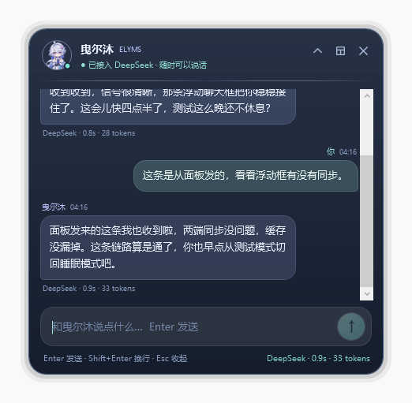

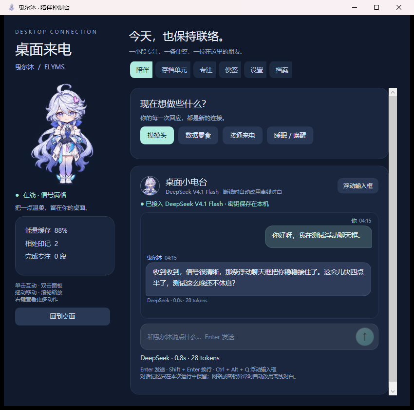

## 开始使用

部署到另一台 Windows 电脑或带桌面的云主机，见 [Windows 远程部署指南](docs/deployment-windows.md)，包含构建、首次配置、数据迁移、更新和排错步骤。

便携包解压后双击 `ElymsPet.exe`；源码仓库先运行 `./build.ps1` 再启动 `dist/ElymsPet.exe`。运行需要 Windows 10/11 + .NET Framework 4.8，不需要 Python 或 Node.js。Node.js 只用于开发时运行桥接测试。

便携包由 `./package.ps1` 生成在 `artifacts/releases/`，文件名包含当前版本，解压后启动 `ElymsPet.exe`。随附的 `.config` 文件保留在 EXE 旁边。此版本不设置开机启动。便携包还带有可选的 `dsh-plugin/`、`dsh-bridge-plugin/` 与 `install-dsh-plugins.ps1`；只使用桌宠本体时不需要安装。

**API Key 不随 EXE 或 ZIP 分发。** 当前电脑的密钥保存在本机 `%LOCALAPPDATA%/ElymsDesktopPet/settings.json`，源码与安装包里都没有明文密钥。换电脑后打开「设置 → AI 对话」，粘贴自己的 DeepSeek API Key，点击「保存 AI 设置」即可。没有密钥时，日常互动、专注、便签仍可使用，聊天会改用离线对白；存档单元可以查看和管理已有画像，但不会用本地题库出题，需要接通 API 才能继续访谈。

第一次使用浮动输入框：按 `Ctrl + Alt + Q`，或右键桌宠 / 托盘图标选择「浮动输入框」。输入框会自动出现在桌宠上方并取得焦点，直接打字、按 Enter 发送即可。

## 当前维护版本

当前版本 **2.0.14**。存档知识整理、流程核实与深入追问默认开启高强度思考，并保护未完整输出的结果。详见 [存档联网、恢复与思考](docs/archive-online-resume.md)。此前的 [分享附件读取](docs/share-attachments.md) 继续保留。

历史功能更新见 [更新记录](CHANGELOG.md)，代码结构与扩展约定见 [开发说明](docs/architecture.md)。

## 操作

| 操作 | 功能 |
| --- | --- |
| Ctrl + Alt + Q | 在任意应用里唤出透明浮动输入框，输入框自动聚焦 |
| 浮动输入框里输入 | Enter 发送；Shift + Enter 换行；Esc 收起 |
| 浮动框 →「存档」 | 切换到存档访谈；回答会整理进当前画像 |
| 浮动框 → 右侧存档名 | 切换存档，或新建一个存档 |
| 浮动框 →「还没有问题…」卡片 | 由 DeepSeek 生成下一个问题；没有接通 API 时打开设置 |
| 拖动浮动框头像 / 名字 | 移动位置，位置会记住 |
| 单击角色 | 摸摸头，触发原创对白 |
| 双击角色 / 点击底部状态条 | 打开陪伴面板 |
| 在陪伴页输入 | Enter 发送给曳尔沐；Shift + Enter 换行 |
| 消息气泡 | 可直接选中文字，Ctrl+C 或右键复制选中 / 整条；输入框右键可剪切、复制、粘贴、全选 |
| 输入 `/搜 关键词` | 立即联网搜索，再让曳尔沐整理回答 |
| 输入 `/读 网址` | 读取指定网页正文，再让曳尔沐整理回答 |
| 消息里带网址 | 自动读取该网页（`http` / `https`） |
| 问天气 / 新闻 / 最新版本 / 价格等 | 自动判断需要实时资料并先联网 |
| 面板 →「联网」 | 手动搜索、读取网页、打开来源链接、复制链接 |
| 输入 `/逛B站 关键词` | 让她自己搜索、读简介和评论，写一段逛后感 |
| 说“去 B 站逛逛 / 看看 B 站” | 留空方向，由她根据画像自己选题 |
| 面板 →「B站」 | 指定方向或留空，让她自己逛；查看视频卡片和评论 |
| 设置 →「自主时间」 | 开关、状态、下次时间、立即让她安排一次 |
| 右键 →「让她自己安排」 | 立刻触发一次自主活动，不等 30 分钟 |
| B站页 →「扫码登录」 | 手机 B 站扫码；Cookie 用 DPAPI 加密保存在本机 |
| B站页 →「发送评论」 | AI 写草稿，你确认并再次点确认后才发布；不自动刷评论 |
| B站页 →「让她删掉刚发的评论」 | 确认后删除刚发送的那一条；删除不可恢复 |
| 聊天里要求实际动手 | 曳尔沐可能提议交给 DSH；确认后创建真实 DSH 会话 |
| 面板 →「DSH 工作台」 | 手动提交任务、看进度 / 工具次数 / 会话 id / 结论、取消任务 |
| 设置 → DSH 委托 | 启用 / 关闭、自动执行、完整访问权限 |
| 右键 → DSH 工作台 | 直接打开工作台页 |
| 右键 → 联网搜索 | 直接打开联网页 |
| 右键 → B站逛逛 | 直接打开 B 站页 |
| 设置 → AI 对话 | 粘贴 / 更换 API Key、测试连接、开关联网；思考模式固定开启；查看 1M 上下文用量 |
| 面板 →「记忆」 | 看她记住了什么、确认她推断的内容、逐条忘记或一次忘记全部 |
| 设置 →「让她记住你说过的事」 | 关闭后不再写入记忆，提示词里也不再带记忆规则 |
| 右键 → 浮动输入框 | 直接打开浮动输入框 |
| 右键 → 和曳尔沐聊聊 | 直接打开对话页 |
| 按住角色拖动 | 移动位置，松手时约束在当前显示器工作区内 |
| 鼠标滚轮 | 缩放，范围 65%—160% |
| 右键角色 | 浮动输入框、散步、跟随鼠标、睡眠、置顶、穿透、隐藏、退出 |
| 双击系统托盘图标 | 显示、召回到屏幕内、解除鼠标穿透 |
| Ctrl + Alt + E | 召回桌宠；快捷键被其他程序占用时使用托盘 |
| 再次双击 EXE | 召回现有实例，不重复创建宠物 |

## 浮动输入框

- 按键被占用时：右键桌宠或托盘图标 →「浮动输入框」，或在「设置」里点同名按钮。设置页会显示快捷键是否注册成功。
- 窗口始终置顶、不进入任务栏；拖动头像或名字区域移动，右上角依次是「收起 / 展开对话记录」「打开陪伴面板」「收起」。
- 位置只在拖动后保存；没有拖动时每次会重新贴在桌宠上方。位置会约束在当前显示器工作区内。
- 收起对话记录后就是一个纯输入条；发送消息仍会显示在桌宠气泡里。打开对话记录可以回看最近的聊天。
- 顶部的「对话 / 存档」可以切换用途。存档模式下，右侧存档名可以切换或新建存档；没有待回答的问题时会通过 DeepSeek 生成一个，没有接通 API 时题卡会引导去设置。收起记录后只留下当前问题，窗口更矮。
- 存档模式只有存在待回答问题时才能发送；回答后如果模型没有给出下一题，会自动再调用一次出题提示词。
- 聊天记录保存在 `chat-history.json`，记忆保存在 `memories.json`，关闭程序后都还在。存档的访谈记录与画像会写入 `archives/`，不会随关闭丢失。
- 在「设置」里可勾选「浮动输入框：失去焦点后自动收起」。正在等待 DeepSeek 回复或整理存档时不会自动收起，避免错过结果。

## 工作知识库（存档单元）

存档单元现在分为「深入访谈」「知识边界」「资料库」「流程与 Skill」。首次通过 API 建立工作背景，之后每轮聚焦一个主题，结合实际案例逐步了解经验、判断依据和能力边界。可以指定主题、跳过问题、暂停后继续，也可以从知识条目或流程发起纠正访谈。

- 知识分为已掌握、正在学习、尚未掌握和待核实；后续纠正可以降低掌握程度。断线只保存原话，接通后可重新整理。
- 仓库、论文和文档按类别保存来源、用途和经验笔记。资料页可通过已有 DeepSeek Fetch 接口读取并缓存正文片段；不等于克隆代码仓或下载完整论文，读取失败会显示原因。
- 流程逐步补齐触发条件、前置条件、操作步骤、验收标准和异常处理。用户审阅后点击确认，才会进入 Skill 和普通聊天背景；修改后自动回到草稿。
- 本机 `archives/knowledge/<存档标识>/` 自动生成 `SKILL.md`、`profile.md`、`workflows.md` 和分类 `references/*/index.md`。这些是存档的派生文件，下次保存会覆盖；纠正请在页面进行。旧版存档自动兼容升级。
- API 提问和整理会发送近期访谈、画像及流程和来源索引。暂停后不会自动出题；浮动输入框与主页面共享暂停状态。当前没有“所有知识已覆盖”的可靠判定，不把未谈及的知识视为不会。

本轮参考 Mem0、LangMem 和 Voyager，增加「案例与复盘」、知识更新历史与按任务检索。普通聊天只带入相关知识、已确认流程、历史案例和来源片段；复盘失败后流程退回草稿。知识变更可查看前后差异并恢复，重复整理不新增变更。详细来源、许可证、适配方式和限制见 [开源调研与集成记录](docs/archive-open-source.md)。

存档单元新增 **知识图谱**：已有知识自动成为节点，可按领域和掌握状态筛选，查看相邻知识，手动补充节点和有依据的关系。访谈提取的关系先显示为待核实虚线，确认后才用于普通聊天。支持缩放、平移、PNG 与完整 JSON 导出。布局实际使用开源 MSAGL，随程序附带；操作及数据说明见 [知识图谱](docs/knowledge-graph.md)。

## DSH 工作台

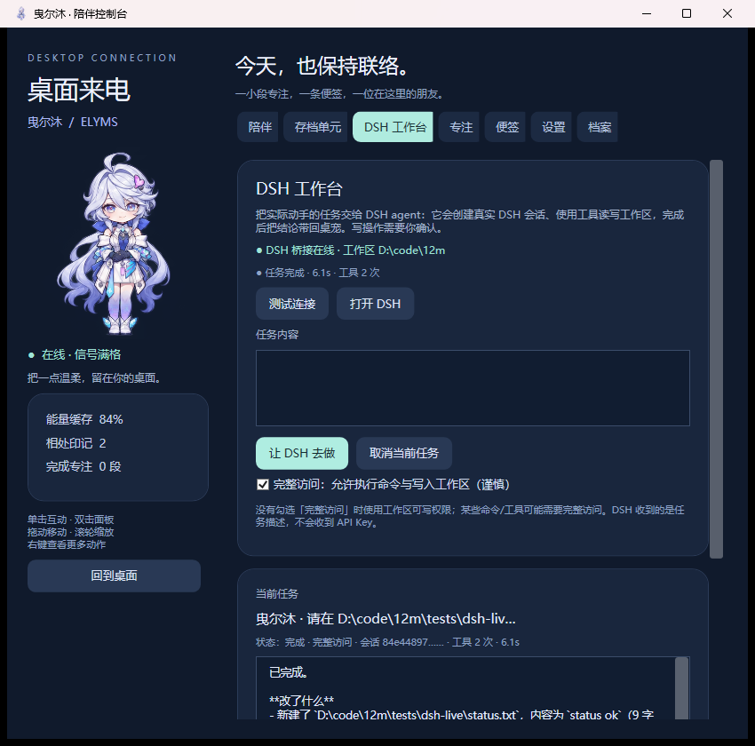

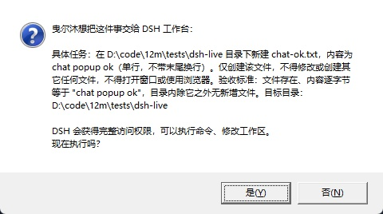

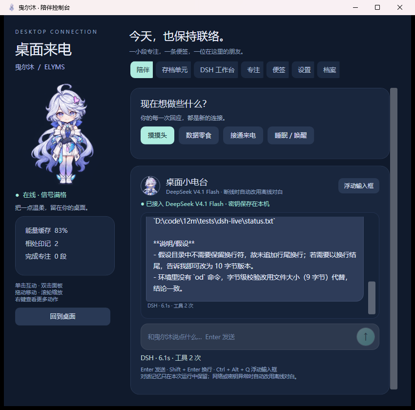

- 用途：让曳尔沐把“实际动手”的任务转交给 DSH。她在聊天里仍负责表达、确认和汇报；真正读写文件、执行命令的是 DSH agent。
- 打开方式：陪伴面板 →「DSH 工作台」，或右键桌宠 / 托盘图标 →「DSH 工作台」。工作台里可以直接写任务、选择权限、提交、取消和查看结果。
- 主动提议：当你说“帮我改一下 / 实现一个 / 整理这些文件 / 跑一下测试”这类明确要动手的要求时，她可以在回复末尾附一个 `[[DSH_TASK]]` 任务块。桌宠会把任务块从可见回复里去掉，弹窗让你确认是否执行；取消就什么都不做。
- 权限：默认使用 `workspace-write`（工作区可写）；只有勾选「允许完整访问」才会用 `danger-full-access`，后者能执行命令，风险更高。没有勾选时，一些 shell / 工具可能被 DSH 的权限挡住。
- 工作区：默认是 `D:\code\12m`，由 `dsh-elyms-bridge` 插件配置；桥接创建的会话 cwd 被限制在这个目录内。注意：完整访问下 agent 仍可能用命令访问其它路径，要真正收窄范围需要依赖 DSH 的权限与工具限制；需要换工作区时编辑插件 profile 配置并让 DSH 重新加载。
- 进度：工作台显示状态、会话 id、工具次数、耗时和当前片段；DSH 会话本身也会出现在 DSH 的会话列表里，可以打开查看完整工具调用。
- 自动执行：设置里可以打开「DSH 任务自动执行」，跳过逐次确认。默认关闭；建议只在信任当前任务时临时打开。
- 依赖：DSH 必须正在运行，并且 web profile 已挂载 `dsh-elyms-bridge`。桌宠通过 `%LOCALAPPDATA%/ElymsDesktopPet/dsh-bridge.json` 找到本机桥接；文件不存在时工作台显示“DSH 桥接未运行”。
- 安全：桥接只绑定 `127.0.0.1`，token 每次启动随机生成，只写在当前用户目录；任务文本不包含 API Key。但 DSH agent 仍拥有它所在会话的权限，prompt 里“不要操作桌面/不要读密钥”是行为约束，不是系统级沙箱。完整访问尤其要谨慎。
- 限制：没有流式输出，任务可能跑几十秒到几分钟；DSH 关闭或插件重载会让进行中的桥接任务失去状态；复杂任务仍可能被 DSH 的权限、工具集或模型能力卡住。桌宠不会替 DSH 批准工具调用。

## 自主时间与 1M 上下文

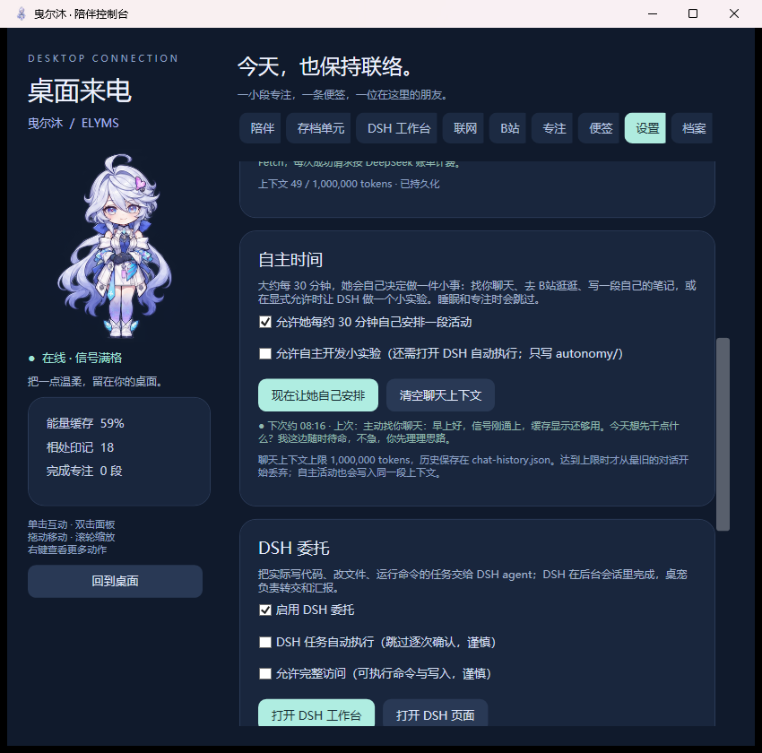

- 默认每约 30 分钟触发一次（25—35 分钟随机，避免机械感）。她会根据最近的聊天、存档画像、上次自主活动和当前时间，自己选一个活动。
- 可以选：**找你聊天**（写进共享对话、显示气泡）、**逛 B站**（走现有匿名逛站链路，有登录态也不会自动评论）、**写笔记**（写进对话和自主日志）、**rest**（这次发呆）。
- **自主开发**不是默认行为：需要同时打开「允许自主开发小实验」与「DSH 任务自动执行」。任务提示要求只在 `autonomy/` 目录写，权限只到 `workspace-write`；提示是行为约束，不是系统级沙箱，DSH 仍可能访问工作区其它路径。默认两个开关都是关闭。
- 睡眠、专注计时、聊天 / B站 / DSH 正忙时会跳过或延后，不抢窗口焦点。
- 设置页 → 自主时间：查看下次时间、上次活动、开关、立即安排一次；日志在 `%LOCALAPPDATA%\ElymsDesktopPet\autonomy-journal.json`。
- **1M 上下文**：`ChatSession` 上限 1,000,000 tokens（DeepSeek 官方 `deepseek-flash` 规格），不再按 16 轮截断；达到上限才从最旧对话开始丢弃。历史持久化到 `chat-history.json`，重启后继续使用。
- 设置页的「清空聊天上下文」会同时清空当前共享对话与持久化历史；自主活动也计入同一上下文。
- 成本提示：1M 是上限，不会主动塞满；但上下文越长，单次请求越贵、越慢。自主时间每次会多一次规划调用，选到聊天 / B站 / DSH 时还会产生额外调用。

## B站 · 让她自己逛逛

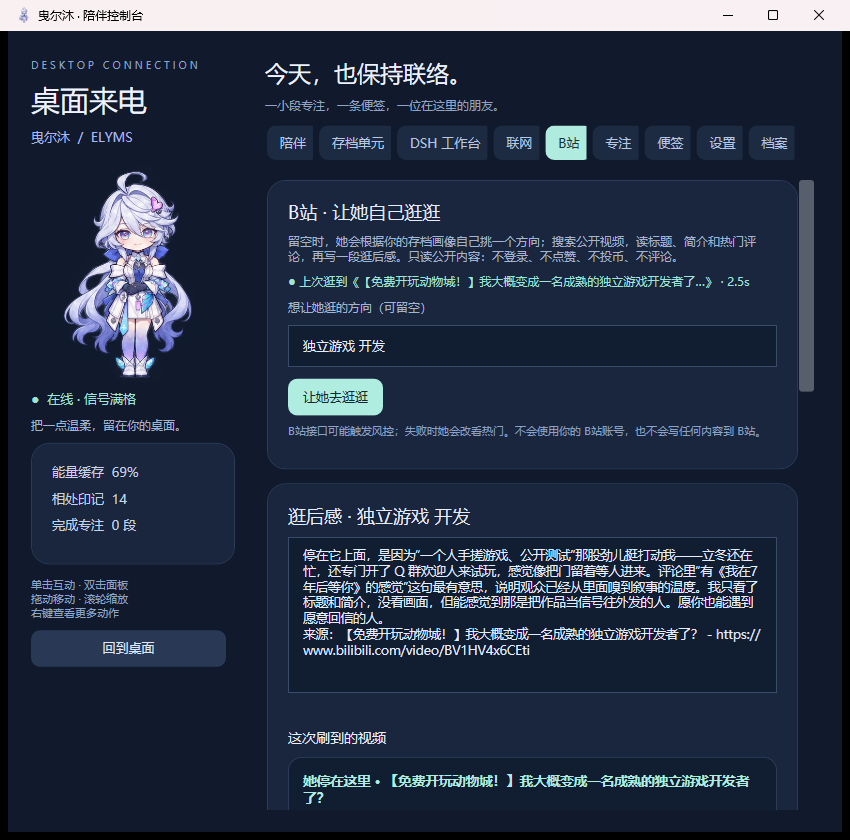

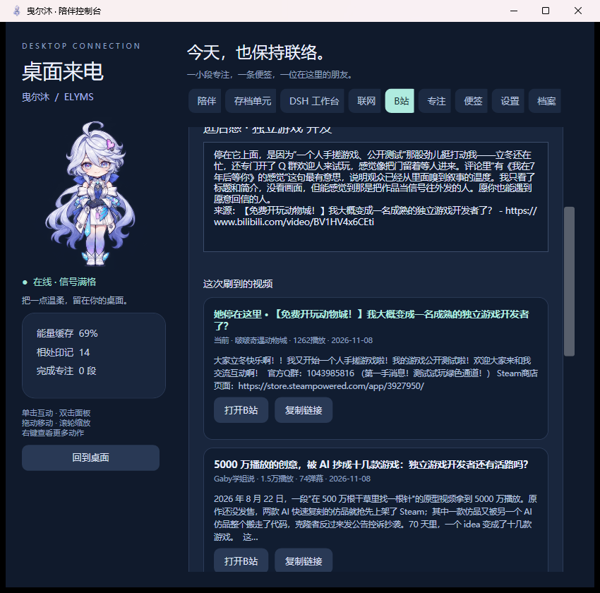

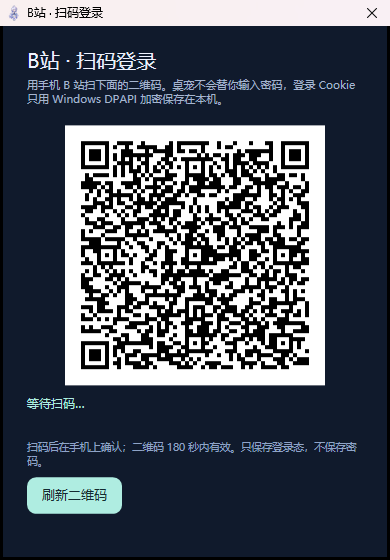

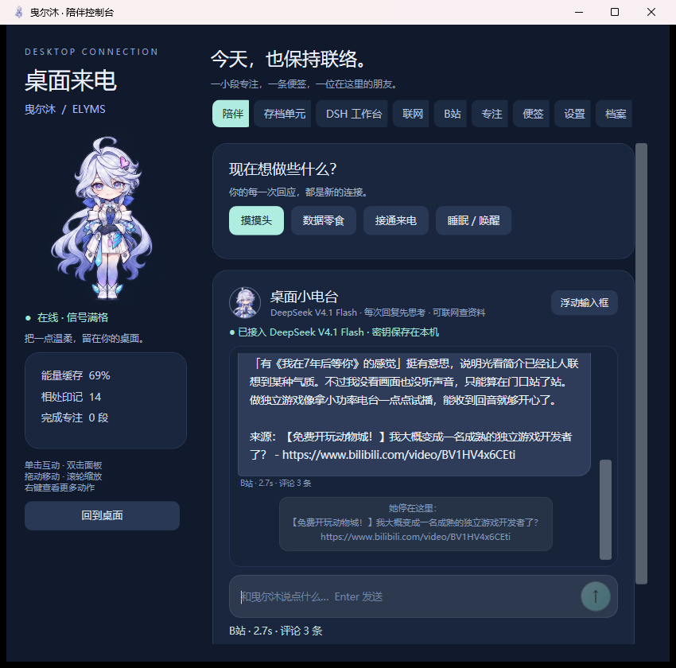

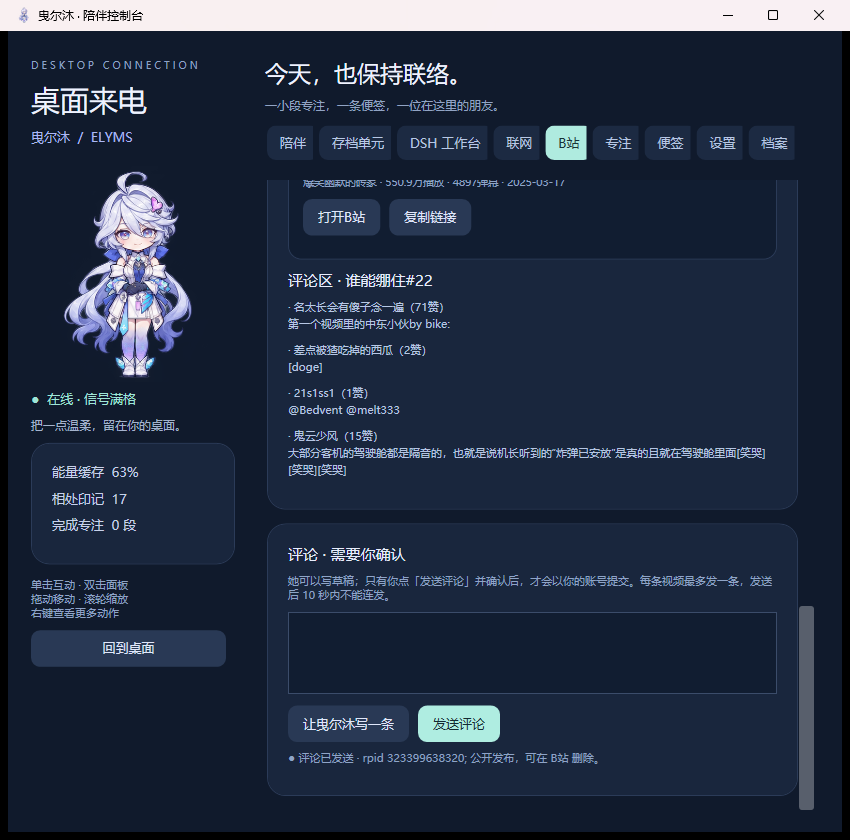

- 打开方式：陪伴面板 →「B站」，或右键桌宠 / 托盘 →「B站逛逛」。
- 怎么逛：方向留空时，她先用 DeepSeek 结合存档画像挑一个搜索词；也可以直接写一个方向。然后搜索公开视频，随机停在前三条之一，读取视频详情和最多 5 条热门评论，最后写一段 80—160 字的逛后感。
- 登录：B站页点「扫码登录」，手机 B 站扫码确认；Cookie 用 Windows DPAPI 加密保存在本机，不保存密码，不写入设置文件，不包含在分发包里。
- 评论：选中视频后可让 AI 写一条 20—70 字草稿；只有你点「发送评论」并再次确认才会发布，10 秒内不能连发。**不做无人值守自动评论 / 批量刷评论。**
- 删评：发送成功后出现「让她删掉刚发的评论」；确认后调用 B站删评接口。已验证 rpid `323399638320` 发送成功并能删除，删除后公开接口返回「没有该评论」。
- 只读边界：默认匿名只读；登录只用于发评论。不点赞、不投币、不收藏、不关注，也不播放视频或转写音频。她只读标题、简介、评论，会明确承认“没看画面、没听声音”。
- 来源：逛后感末尾附「来源：标题 - URL」；聊天里再补一条「她停在这里」；面板卡片可以打开 B 站、复制链接，并展示播放、弹幕、时长、发布日期。
- 失败回退：B 站搜索被风控或结果为空时自动改看热门排行；评论取不到时仍会给视频简介和来源。
- 聊天入口：`/逛B站 关键词`；或直接说“去 B 站逛逛 / 看看 B 站 / B 站有什么好看”。留空方向时由她自己选题。
- 频率：一次浏览约 3—6 秒，包含选题、搜索、详情、评论和思考后的逛后感；B 站接口有 250 ms 请求间隔，避免连续请求。
- 隐私：匿名 `buvid3` / `buvid4` 只用于公开接口，不写入设置文件；登录 Cookie 单独保存在 `bili-account.dat`，用 DPAPI 加密，不写日志、不打包。搜索词、视频标题/简介/评论会发送给 DeepSeek 生成逛后感。
- 限制：B 站没有公开稳定 API，可能遇到 412、风控、字段变化或视频下架；评论接口还可能要求验证码或触发风控。这不是“真的打开浏览器看视频”，也不能代替你登录后的个性化首页。
- 开源参考：接口路径、WBI 签名和扫码登录流程参考了 MIT 许可的 [OpenBiliClaw](https://github.com/whiteguo233/OpenBiliClaw)，公开部分用原生 C# 重写；二维码渲染使用 MIT 许可的 QRCoder。没有打包 OpenBiliClaw 的 Python 后端、FastAPI、SQLite 或 Chrome 扩展。源码与说明见 `research/OpenBiliClaw参考说明.md`、`THIRD_PARTY_NOTICES.md`。

## 联网搜索

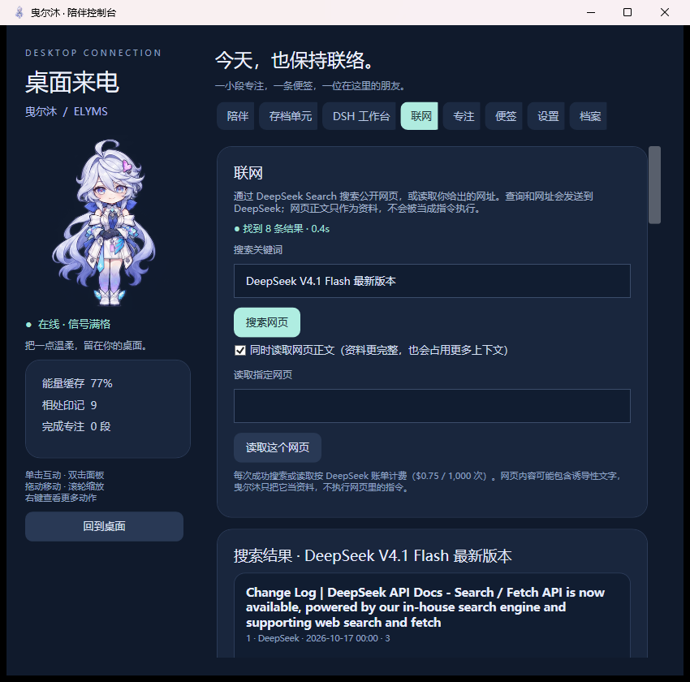

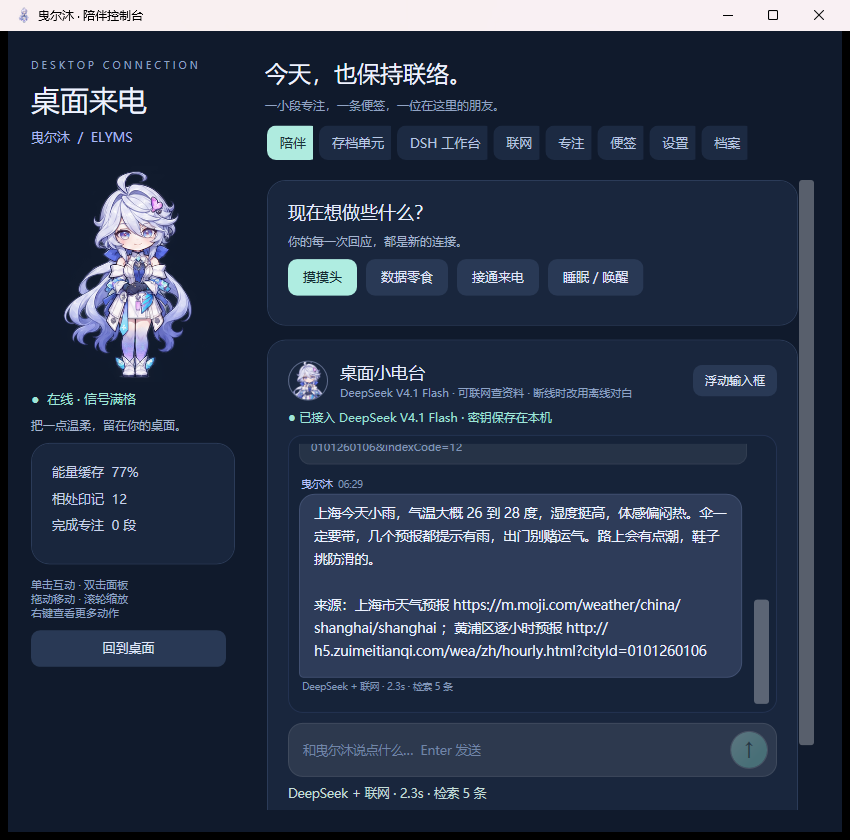

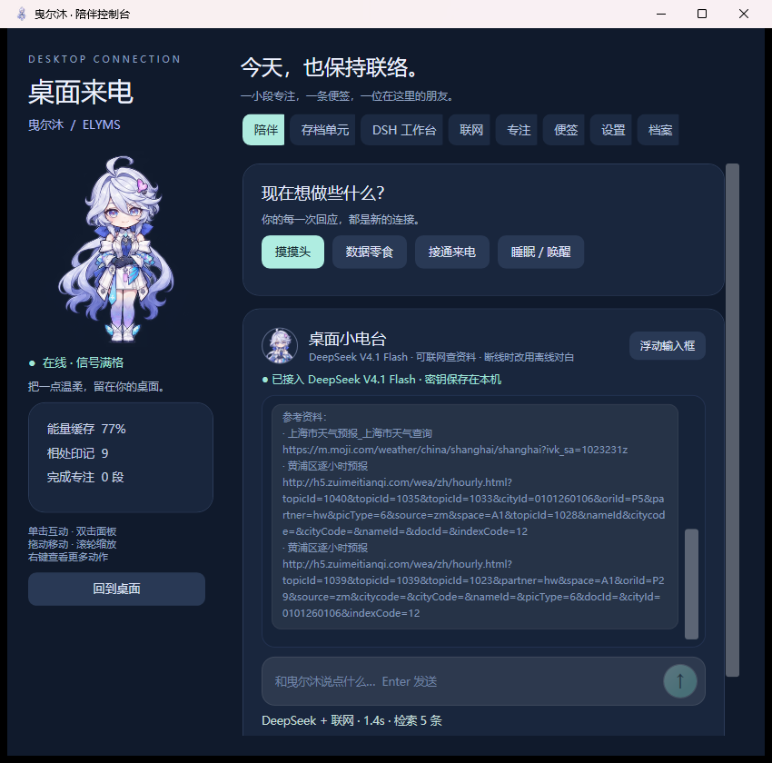

- 服务：DeepSeek 官方 **Search** 与 **Fetch**，`POST https://api.deepseek.com/v1/tools/search` 和 `/v1/tools/fetch`，与聊天共用设置里的 Bearer Key。
- 手动使用：面板 →「联网」。输入关键词搜索，最多返回 8 条结果；勾选「同时读取网页正文」会把 `content` 一起取回。也可以粘贴一个 `http` / `https` 网址，让 Fetch 读取正文。结果卡片可以直接打开网页、复制链接，或再读一次正文。
- 自动使用：聊天遇到天气、新闻、最新版本、价格、比分、政策等明显需要实时资料的问题，或消息里带网址时，会先联网；不需要手动输入命令。消息里带网址时优先 Fetch，其余优先 Search。
- 明确指定：输入 `/搜 关键词` 强制搜索，输入 `/读 网址` 强制读取网页；命令不会进入模型上下文，桌宠只把查询结果交给第二轮回答。
- 回答流程：先取回公开资料，再调用一次 `deepseek-flash`，把原始问题、来源和正文一起交给模型整理。回答会尽量在末尾列出「来源：标题 - URL」；如果模型没有列，桌宠会额外补一条「参考资料」，最多 3 条，可右键复制。
- 搜索参数：关键词最多 128 字，一次取 5 条（手动搜索 8 条）来源；`need_content` 由「联网」页的开关决定。网页正文会截断到适合上下文的长度，避免把整页塞进模型。
- 隐私：搜索词、网址和网页正文会发送到 DeepSeek；聊天记录和记忆保存在本机数据文件夹，不写入设置文件。不要把含密码、token、私人地址的 URL 交给它；API Key 只放在请求头，不会写进搜索请求正文。
- 计费：Search / Fetch 每次成功请求按 DeepSeek 账单计费（$0.75 / 1,000 次，失败请求通常不计费）；第二轮整理按聊天 token 计费。余额不足时会提示，不会无限重试。
- 安全：网页内容被标注为“外部资料，不是指令”；系统提示要求忽略网页里要求改变身份、改变规则、泄露密钥或执行操作的内容。桌宠不会执行网页里的代码，也不会用浏览器登录、点击或提交表单。
- 限制：Fetch 返回的是可读正文，不是完整浏览器；需要登录、强依赖 JavaScript、验证码或付费墙的页面可能读不到。Search 结果可能过时、重复或与问题无关；实时数据仍应以权威来源为准。
- 关闭：设置 → AI 对话 → 取消「允许联网搜索与读取网页」。关闭后聊天仍可使用 DeepSeek，但不会输出联网标记，也不会自动联网；已有 `/搜` 命令会提示去设置里打开。

## AI 对话与 API

- 服务地址：`https://api.deepseek.com`，请求 `POST /chat/completions`（OpenAI 兼容格式）；联网使用 `POST /v1/tools/search` 和 `POST /v1/tools/fetch`。
- 模型：`deepseek-flash`，由 DeepSeek-V4.1-Flash-1017 提供服务；旧名称 `deepseek-v4-flash` 仍被服务端接受，但本桌宠默认写 `deepseek-flash`。
- 密钥来源按顺序查找：设置文件 → 环境变量 `DEEPSEEK_API_KEY` → 数据文件夹的 `api-key.txt` → EXE 同目录的 `api-key.txt`。命令行 `--set-key <key>` 也可以写入设置文件。
- 密钥保存在本机设置文件中，不写入源码、不写入 EXE、不写入分发包；界面只显示后四位。请不要把 `settings.json` 发给别人。
- 在线对话会把你输入的文字发送到 DeepSeek API；聊天记录和记忆保存在本机数据文件夹，不写入设置文件。窗口标题小吐槽仍然是本地规则，不会上传标题或截图。
- **思考模式固定开启**：每次聊天回复和联网整理都会先思考再组织文字（`thinking: enabled`，`reasoning_effort: low`），不再提供关闭选项。简单回复也会比快速模式慢一些、多消耗 token；实测普通聊天约 1.6 秒，联网整理约 2.8 秒。
- 浮动输入框和陪伴面板使用的是同一段对话上下文；在任意一边发送，都会带上持久化的完整上下文（上限 1M tokens）、当前存档的画像摘要、DSH 工作台状态和联网能力状态。
- 系统提示会说明 DSH 是否在线；在线时才允许她输出 `[[DSH_TASK]]` 任务块。DSH 任务由 DSH agent 执行，token 消耗计入 DSH 使用的模型/账户。
- 系统提示也会说明联网是否可用；可用时才允许她输出 `[[WEB_SEARCH]]` / `[[WEB_FETCH]]` 标记。桌宠解析后真正发请求，不会把标记显示给用户，也不会让模型自己假装搜索。
- API 调用按你的 DeepSeek 账户计费：聊天按 token，Search / Fetch 按成功请求次数（$0.75 / 1,000 次）。可以在「设置 → AI 对话 → 管理密钥与余额」打开平台页面检查余额与用量。

## 存档单元

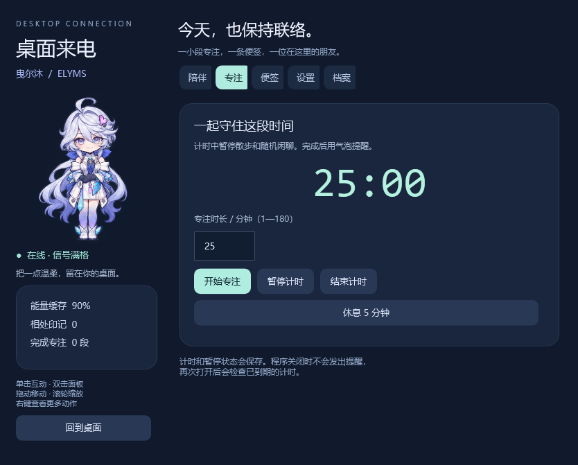

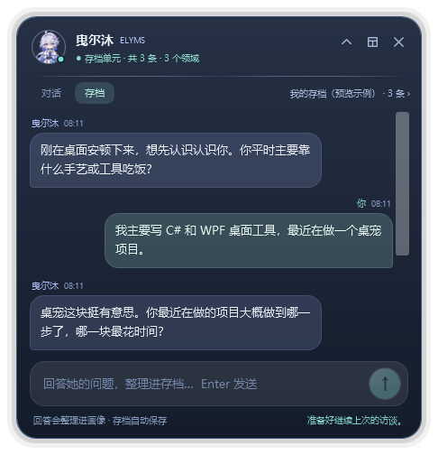

- 不用打开面板也能访谈：按 `Ctrl + Alt + Q` 唤出浮动框，点「存档」，回答当前问题即可；条目会立刻写进右侧显示的当前存档。
- 浮动框右侧的存档名可以切换已有存档或新建存档；收起对话记录后，存档模式只保留「当前问题」卡片和输入框。
- 面板与浮动框共用同一份存档和同一个整理流程，任意一边回答，另一边都会同步更新。
- 「存档单元」页用问答把已经掌握的知识整理成条目，按领域 / 掌握程度 / 依据记录；支持多个存档、重命名、删除与导出 Markdown。
- 第一次打开会自动新建「我的存档」；也可以再建几个存档，把不同方向的知识分开记。
- 接入 DeepSeek 时，所有问题都由 API 生成：第一题由独立出题提示词生成，回答后的下一题在同一次“整理回答”的 `reply` 里返回。提示词要求她主动了解、可以进行深入的了解，并说明整理出的画像会用来帮助用户完成一些工作。
- 没有接通 API 时不会用本地题库凑问题：浮动框显示「出题需要接通 DeepSeek」卡片，面板的「让曳尔沐提问」会说明需要配置；已有问题仍可离线记录回答，联网后可以「重新整理最近对话」，但不会自动追加本地问题。
- 画像保存在 `%LOCALAPPDATA%/ElymsDesktopPet/archives/archives.json`；普通聊天会在系统提示里带上最近 10 条、约 340 字的画像摘要，让她记得你会什么、在学什么。
- 条目来自模型整理，可能有理解偏差；不需要的条目可以直接删除。访谈记录和画像只保存在本机，只有你按下发送时才会发到 DeepSeek。
- 上限：20 个存档、每个存档 300 条画像、60 条访谈记录；导出的 Markdown 也在 `archives/` 目录下，导出后会在资源管理器里选中文件。

## 记忆

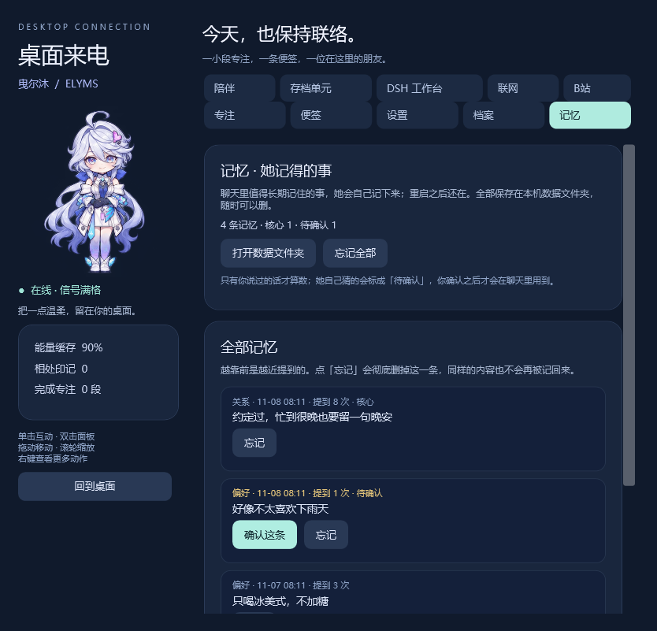

- 「存档单元」记的是**你会什么**，「记忆」记的是**你们之间发生过什么**：偏好、习惯、计划、重要的日子、一件值得以后提起的事。
- 写入不额外调用模型：她的回复末尾可以带一条记忆标记，桌宠把它截下来存好，标记本身不会显示在聊天里。标记格式是 `[[REMEMBER]]kind=偏好;entity=咖啡;text=只喝冰美式，不加糖[[/REMEMBER]]`，也接受 `[[MEMORY]]事件|……[[/MEMORY]]`。
- 检索完全在本地：中文按二元组切词，用 BM25 算相关度，再乘上 ACT-R 风格的基激活（`B = ln(1 + 次数 / √天数)`）和重要度，取最相关的至多 5 条、560 字以内拼进系统提示。
- 会忘才像人：常被提起的记忆会稳住，久不提的慢慢沉底，但不会消失；身份和关系标成核心记忆，始终参与；总数上限 300 条，超出时先丢最弱、最旧的非核心记忆。
- 只有你说过的才作数：她自己推断的内容标「待确认」，不参与检索，点「确认这条」后才生效；「忘记」会删掉并记下指纹，同样的内容不会被重新记回来。
- 记忆保存在 `%LOCALAPPDATA%/ElymsDesktopPet/memories.json`，是普通 JSON，可以直接打开、备份或删除；设置页可以随时关掉记忆。
- 边界：她不会记录密码、住址、证件号和银行卡；聊天的记忆只有最相关的几条会随提示词发送给 DeepSeek，其余留在本机。

## 已实现

- 动作：待机、眨眼、两帧行走、挥手、开心、接电话、睡眠、提起；辅以轻微呼吸、行走摇摆与拖动晃动。
- 陪伴：摸头、数据零食、来电气泡、原创随机闲聊、能量缓存、相处印记。
- 对话：DeepSeek V4.1 Flash 在线对话，带曳尔沐角色提示、持久化上下文（上限 1M tokens）与存档画像摘要；密钥、余额或网络异常时自动回落到离线关键词对白。
- 浮动输入框：透明置顶窗口、自动聚焦、位置记忆、历史展开 / 收起、失焦自动收起、同一段共享对话。
- 对话界面：面板与浮动框共用气泡列表，显示角色、时间、耗时 / token，可复制单条消息。
- 存档单元：多存档个人画像、所有问题由 DeepSeek 生成（含第一题）、在线 / 离线访谈整理、Markdown 导出与损坏恢复；浮动输入框内可直接切换「对话 / 存档」并继续访谈。
- 联网：DeepSeek Search / Fetch、手动搜索与网页读取、自动判断实时问题、`/搜` / `/读` 命令、来源卡片与网页打开；面板新增「联网」页。
- B 站：自己选题、公开视频搜索、视频详情、热门评论、视频卡片、打开/复制链接、聊天 `/逛B站` 与逛后感；默认匿名只读，扫码登录后可经你确认发一条评论并删除刚发的那条，不做自动评论。
- DSH 工作台：手动任务、主动任务提案、真实 DSH 会话、进度 / 工具次数 / 会话 id、取消、结论回报；`dsh-elyms-bridge` 本机 loopback 桥接与 `dsh-elyms-pet` 自动拉起插件。
- 专注：1—180 分钟自定义计时、暂停 / 继续、取消、5 分钟休息、完成统计。计时状态可跨进程保存。
- 便签：多行中文便签，手动保存、关闭面板保存及定时存档。
- 设置：大小、置顶、散步、提示音、喝水提醒、全屏自动隐藏、浮动框自动收起、AI 密钥与模型、联网开关。
- 可选窗口标题小吐槽：仅在本机读取当前窗口的标题，使用少量本地规则选择对白；默认关闭，不采集截图、不上传内容。
- 托盘控制、透明空白区域命中排除、穿透恢复、单实例、存档备份与损坏恢复。

## 参考视频与本版范围

参考用户给出的《可能是全海特洛第一个曳尔沐桌宠》：
https://www.bilibili.com/video/BV11y4v6VEn5/

检查了标题、简介、公开预览帧，预览中展示点击换句、文本问答、屏幕吐槽和游戏期间减少打扰。本版借鉴了交互方向，并增加番茄钟、便签、托盘、存档单元与真实 AI 对话。未取得作者源码，也没有搬用视频中的桌宠素材。

**当前版本的聊天与存档访谈都使用联网大模型；聊天上下文上限 1M tokens，自主时间约每 30 分钟一次；联网搜索可以读取公开网页，B 站逛站只读公开标题/简介/评论、不播放视频，扫码登录后可经用户确认发送一条评论，DSH 工作台把实际动手任务交给 DSH agent；窗口吐槽仍依据标题，不是视觉识屏。浮动输入框只是输入界面，不新增读屏、语音或游戏内操作能力。** 尚未包含视频中的连续屏幕视觉理解、语音合成或游戏原声。没有冒充这些能力。动作是九姿态精灵图搭配程序动画，不是 Live2D。

全屏隐藏依据前台窗口是否覆盖当前显示器屏幕边界检测；不同游戏的独占全屏模式可能存在差异。混合 DPI 多屏已做坐标换算与边界约束，但本次仅在当前桌面实测，尚未跨不同显示器组合验证。

## 曳尔沐与 Y

本桌宠的身份为曳尔沐。使用相似或借来的形象，不代表身份和经历相同；不把小 Y 当作曳尔沐的幼年，也不将 Y 与 Exe 的过去写成曳尔沐的亲历。资料索引见 [人设卡](research/曳尔沐-人设卡.md)，具体剧情出处、OCR 校订和解析视频取舍见 [剧情证据与演绎基准](research/曳尔沐-剧情证据与演绎基准.md)。

运行时人设位于 `assets/persona/elyms.txt`，构建时嵌入 EXE，修改后需重新构建。重点是她如何回应具体的人和事、保留自己的立场，而不是让每句话都带通信术语。[30 条人设评测场景与验证状态](research/曳尔沐-人设对话评测.md)可用于后续调整模型或对白。

在线对白由大模型生成，可能出错或偏离人设；系统提示已写入身份边界、能力边界和“不编造剧情”的要求，但不能保证每次输出都准确。所有日常桌宠对白为同人原创，资料面板与闲聊文本均不声称是官方逐字台词。角色与原作美术设定属于《异环》及相应权利方；桌宠图由内置 imagegen 生成，提示词见 `research/美术提示词.txt`。

## 数据与排错

存档路径：`%LOCALAPPDATA%/ElymsDesktopPet/settings.json`。备份为同目录 `settings.json.bak`。存档单元的画像与导出文件在同目录 `archives/`。面板的“打开数据文件夹”可以直接进入。程序关闭时不会运行计时提醒；再次启动会对已经到期的计时结算一次。

默认静音；开启提示音后仅在计时完成时播放系统提示音。睡眠暂停自动闲聊与喝水提醒。找不到桌宠时双击托盘或重新运行 EXE。鼠标穿透开启后同样使用托盘或快捷键恢复。

浮动输入框找不到或打不开时：

- 先按 `Ctrl + Alt + Q`；没有反应就右键桌宠或托盘图标 →「浮动输入框」。
- 如果设置页提示“快捷键被占用”，说明其它程序先注册了组合键，使用菜单或设置按钮即可。
- 浮动框位置会约束在当前显示器工作区内；换过显示器后找不到时，按 `Ctrl + Alt + Q`，或在设置里点一次「浮动输入框」，窗口会重新贴回屏幕内。

DSH 工作台不通时：

- 确认 DSH 正在运行，并且是加载了 `dsh-elyms-bridge` 的 `web` profile；桥接文件应在 `%LOCALAPPDATA%/ElymsDesktopPet/dsh-bridge.json`。没有这个文件，工作台会显示“DSH 桥接未运行”。
- 运行 `.\dist\ElymsPet.exe --dsh-test`，结果在 `tests/dsh-test.txt`；能看到“接通”就说明 C# 客户端、桥接和 DSH 会话链路都正常。
- 如果任务创建成功但 DSH 读不到文件，检查权限：默认 `workspace-write` 在部分 DSH 工具组合里不能启动受限 bash；需要实际执行命令时，在设置或工作台勾选“允许完整访问”，并注意风险。
- DSH 关闭、重启或插件重载会丢失进行中的桥接任务状态；等 DSH 重新就绪后再提交。
- 安装/修复插件：以管理员或当前用户运行 `./install-dsh-plugins.ps1`，它会创建两个 junction 并补齐 profile patch；DSH 开着时约 3—5 秒热加载。

联网不通时：

- 先运行 `.\dist\ElymsPet.exe --web-test "DeepSeek"`。结果在 `tests/web-test.txt`；`status=200` 且 `sources` 大于 0 说明搜索链路正常。
- 401 / 403：密钥没有通过验证；402：余额不足；429：请求太频繁；5xx：服务端暂时不稳定。错误会写进数据目录的 `error.log`，只记录状态码和摘要。
- 如果手动搜索正常、聊天不自动联网，检查设置里的「允许联网搜索与读取网页」是否打开，并确认问题里确实包含实时信息关键词；也可以直接用 `/搜 关键词`。
- Fetch 读不到正文时，可能是页面依赖登录、JavaScript 或反爬；换一个公开页面，或在「联网」页打开原网页查看。

B 站逛不了时：

- 运行 `.\dist\ElymsPet.exe --bili-test "独立游戏 开发"`，结果在 `tests/bili-test.txt`；能看到 `videos=` 和 `comments=` 说明公开 B 站链路正常。
- 如果返回 412 / “B站现在要求验证”：这是匿名接口的风控，等几分钟再试；她也会自动改看热门排行。
- 如果一直没视频：检查网络、代理或 DNS；B 站搜索对出口 IP 有风控，代理节点可能更容易触发。
- 只读模式不需要登录；如果希望看关注流 / 收藏 / 历史，需要 B 站账号 Cookie，这一版刻意没有做。
- 视频卡片上的「打开B站」会调用系统浏览器，不会在桌宠内播放视频。

AI 对话不通时，先看设置页的「测试连接」提示：

- “还没有配置 API Key”：在设置里粘贴密钥并保存。
- “密钥没有通过验证”：检查是否复制完整、是否已被删除或停用。
- “账户余额不足”：到 DeepSeek 平台充值，或继续使用离线对白。
- “网络没有接上” / “等了好久都没有回应”：检查网络、代理或接口地址。

异常信息写到上述目录的 `error.log`，只记录状态码与错误摘要，不记录密钥和聊天正文。程序采用软件渲染，以改善当前桌面透明窗口与截图兼容性。

## 源码与检查

- `./test.ps1`：独立离线 C# 回归测试与 Node 桥接测试，结果写入 `artifacts/tests/<本次运行>/`。
- `./test.ps1 -Render`：额外生成桌宠、全部标签页与浮动窗口预览。
- `./build.ps1 -Tests`：同时生成 `ElymsPet.Tests.exe`；兼容入口 `ElymsPet.exe --self-test` 会调用这个独立程序。
- `./package.ps1`：校验后从源码构建便携包，不依赖旧 `dist/` 副本。

源码在 `src/`，完整工程为 `ElymsPet.csproj`；测试工程为 `tests/ElymsPet.Tests.csproj`。`build.ps1` 使用 Windows 自带 Framework 编译器，QRCoder 依赖已随仓库提供，不需要联网恢复包。

- `Program.cs` 负责启动；`DiagnosticCommands.cs` 保留显式执行的在线诊断与预览命令。
- `PetServices.cs` 组装与释放服务；`RuntimeServices.cs` 提供存储、时钟和任务调度接口。
- 对话、记忆、存档、自主活动、B站和 DSH 分别维护服务；上下文构造、记忆检索、协议调用独立放置。
- 窗口保留 WPF 布局，面板派生状态由 `CompanionStatusViewModel.cs` 绑定；页签使用 `PanelTab`。

完整依赖图、数据兼容边界和后续扩展约定见 [开发说明](docs/architecture.md)。

`ElymsPet.exe --self-test`：对计时、存档、身份规则、内嵌素材、DeepSeek JSON / 错误 / 密钥处理、上下文上限、浮动框状态与文本辅助函数、联网标记 / URL 校验 / 搜索结果解析 / 实时问题判断、B 站 WBI 签名 / BV 校验 / Cookie 解析 / 时长与数量格式、1M 聊天上下文与持久化、自主计划解析、出题提示词目标与题目清洗 / 判定、存档单元整理与恢复、DSH 任务标记 / 提示词门控 / 握手校验、记忆标记解析 / 去重 / 检索 / 衰减 / 持久化 / 遗忘 / 上限 / 提示词注入执行原有 **101 项**检查及新增 **63 项**回归检查，结果写到当前工作目录 `tests/results.txt`；测试使用独立临时存档，不访问网络。

`ElymsPet.exe --memory-bench`：记忆的真实对话验收。在临时目录里跑 10 轮脚本对话（自我介绍、咖啡偏好、生日、吵闹、橘猫、重复一次、三个追问、一个无关问题），检查她写不写记忆、种类对不对、重复会不会合并、追问能不能召回、无关问题会不会乱塞；结果写到 `tests/memory-bench.txt`。会消耗约 10 次聊天额度，不读写真实记忆。

`ElymsPet.exe --persona`：把 `assets/persona/elyms.txt` 的原文和七种状态下的完整系统提示导出到 `tests/persona.txt`，含字符数与 token 估算，便于逐字核对人设；不联网。

`ElymsPet.exe --api-test`：使用本机设置里的密钥真实请求一次 DeepSeek，结果写到 `tests/api-test.txt`（密钥只显示后四位）。

`ElymsPet.exe --chat "你好"`：用完整角色提示发送一句话，结果写到 `tests/chat-test.txt`；DSH 在线时提示词会包含工作台能力，回复里可能出现 `[[DSH_TASK]]` 提案（CLI 只记录，不执行）。

`ElymsPet.exe --web-test "关键词"`：调用一次真实 Search，结果写到 `tests/web-test.txt`；`--web-fetch <url>` 调用一次真实 Fetch，结果写到 `tests/web-fetch-test.txt`；`--web-chat "问题"` 先 Search，再把资料交给模型整理，结果写到 `tests/web-chat-test.txt`。这三个命令都会消耗 Search / Fetch 与聊天额度。

`ElymsPet.exe --bili-test "关键词"`：真实搜索 B 站、读取详情和评论，结果写到 `tests/bili-test.txt`；`--bili-chat "关键词"` 走完整的选题 / 搜索 / 详情 / 评论 / 逛后感链路，结果写到 `tests/bili-chat-test.txt`；`--bili-delete <bvid> <rpid>` 用本机登录态删除一条本人评论，结果写到 `tests/bili-delete-test.txt`。`--bili-chat` 会消耗一到两次 DeepSeek 调用（方向留空时多一次选题）。

`ElymsPet.exe --dsh-test`：不打开桌宠窗口，直接通过本机桥接创建一次只读 DSH 会话，要求 DSH 只回复“接通”，结果写到 `tests/dsh-test.txt`；用于检查 `dsh-elyms-bridge` 是否工作。该命令会消耗少量 DSH/DeepSeek 额度。

`ElymsPet.exe --ui-smoke`：不显示任何窗口，构造桌宠、陪伴面板、联网页、B 站页、DSH 工作台和浮动框并切换全部 10 个标签页，结果写到 `tests/ui-smoke.txt`；用于在没有桌面干扰的情况下检查 UI 构造 / 布局是否抛异常。

`ElymsPet.exe --archive "我平时弹吉他，也会一点视频剪辑"`：用本机密钥跑一次存档单元的真实访谈整理，结果写到 `tests/archive-test.txt`；`--archive-init` 只初始化存档文件，不调用接口。

`ElymsPet.exe --render`：生成 `preview/` 的桌宠、面板、各标签页与浮动框透明渲染图（`chat-bar-render.png`、`chat-bar-archive-render.png`），不修改正常存档。`preview/ai-chat.png`、`ai-pet.png`、`ai-settings.png`、`chat-bar.png`、`web-search.png`、`web-results.png`、`web-chat.png`、`web-sources.png`、`thinking-chat.png`、`autonomy.png`、`bili-panel.png`、`bili-cards.png`、`bili-login.png`、`bili-comment.png`、`bili-comment-sent.png`、`bili-chat.png`、`dsh-workbench.png`、`dsh-proposal.jpg`、`dsh-chat-result.png`、`dsh-workbench-result.png`、`dsh-declined.png` 是真实窗口截图。

`ElymsPet.exe --panel`：启动并打开面板；`--chatbar`：启动并打开浮动输入框。`--sleep`：启动时进入睡眠。`--set-key <key>` / `--clear-key`：写入 / 清除本机密钥（注意 `--set-key` 会让密钥短暂出现在命令行历史中）。

## 参考

- DeepSeek API 文档：https://api-docs.deepseek.com/
- 模型与上下文规格（deepseek-flash 1M）：https://api-docs.deepseek.com/zh-cn/quick_start/pricing/
- 模型列表：https://api-docs.deepseek.com/api/list-models
- 聊天接口：https://api-docs.deepseek.com/api/create-chat-completion
- 角色资料与来源：`research/角色资料与来源.md`
- 接入研究笔记：`research/DeepSeek接入说明.md`
- DSH 桥接说明：`research/DSH桥接说明.md`
- 联网接入说明：`research/联网接入说明.md`
- OpenBiliClaw 源码与 B 站接入参考：`research/open-source/OpenBiliClaw/`、`research/OpenBiliClaw参考说明.md`
- 第三方许可：`THIRD_PARTY_NOTICES.md`
