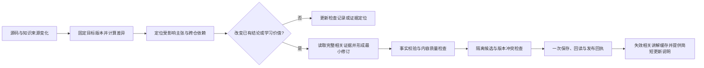

# vLLM / vLLM-Ascend 知识图谱持续演进设计

状态：设计提案，2026-11-16。已阅读项目实现、现有图谱、MindIE Agent 及其 knowledge 运行时，并对两个源码仓库做只读核对。本次没有启用后台任务，也没有修改用户图谱。文中的服务、协议扩展和阈值均为待实现项；阈值是初始建议，不是已经验证的最优值。

核心原则：**自动跟踪证据变化，按需修订已有知识；只有出现独立且重要的新机制，才扩充图谱。** 图谱正文说明当前机制，更新经过、失败尝试和逐提交差异保存在维护记录中。

## 1. 当前基础与真正的缺口

只读检查当前本机派生快照得到：

| 专题 | 节点 / 关系 / 模块 | 源码基线 |
| --- | --- | --- |
| `vllm-ascend-global-main-20261115` | 169 / 99 / 44 | vLLM `5e51c0ca…`、Ascend `3649b8ff…` |
| `vllm-ascend-source` | 63 / 95 / 17 | vLLM `c021a8b0…`、Ascend `e4d533d3…` |
| `archive:vllm-ascend` | 13 / 0 / 0 | 个人访谈记录，无本次可识别的固定提交源码链接 |

维护范围应显式配置到专题 ID。建议首先维护 169 节点的全局专题，旧专题保留为历史学习版本；个人访谈记录不参加源码自动改写。不能根据“最近保存”或名称模糊匹配决定写入对象，也不能每轮建立一个带日期的新专题。

现有实现值得复用：

- `DomainGraph` 已有稳定节点 ID、模块归属、关系与图谱内容哈希 `Revision`；`ArchiveSlot.DomainGraphs` 是业务数据，`graph.json` 是派生快照。
- `ApplyGraphEdit` 已检查 `ExpectedRevision`、节点和关系端点、模块结构，保护用户复述，保存失败恢复内存，并返回保存回执。
- 全局图谱工具已经能固定两仓提交、枚举源码、隔离模块证据、检查引用范围，并对说明完成两轮独立读者审读。
- 本地源码定位已经核对 Git blob，版本不同时可读固定提交快照；已有 DSH 只读研究通道可追踪定义和调用方。

尚缺的关键能力：

1. `Sources`、`Version`、`DomainEdge.Evidence` 主要是文本；无法可靠回答“这句话依赖哪个符号、条件及其他主张”。
2. 当前生成工具面向一次性构建。`package-global-modules.py` 没有把上游 overview 的 `Owns/Excludes` 路由规则作为运行时维护元数据保存；后续不能只靠节点标题定位新增文件。
3. 写入协议只支持增补，无法正式撤回已失效关系；同端点换一个 Label 会留下旧关系。请求去重仅保留最近 100 个 ID，不是长期任务账本。
4. 每次请求最多 30 节点、100 关系；`import-vllm-knowledge.py` 分批提交，每批独立保存，不能作为整轮迁移的原子事务。
5. 讲解过期判断使用整图 `SourceRevision`；无关节点变化也会提示旧讲解过期。反过来，仅有源码上游变化而图谱未变时，也无法识别资料失效。

这些是“证据维护、失效传播与发布”的缺口，单纯增加定时生成不能解决。

## 2. 如何借鉴 MindIE Agent

核对版本：主项目 `bebde27892ef0f6be40c9135047d98320fa7a14d`；knowledge `c164e161b705090c1e14c2779d840f69fee6901a`；knowledge-vllm-ascend `9a614ccda3a82ab863be72edec92ada219af5112`。

| 已阅读的机制 | 对曳尔沐的适配 |
| --- | --- |
| 稳定知识 ID、revision、conditions、provenance、独立的 evidence_strength | 节点身份稳定；重要等级、证据强度和版本新鲜度分别存储 |
| `distill.py` 的价值准入、`noop`、材料摘要与来源校验 | 没有新增学习价值就不改正文；来源必须来自实际读取的本轮证据 |
| `worker.py` 检索已有条目，再生成差量提案 | 生成前强制对照目标节点、同机制候选和适用条件 |
| `reviewed_change.py` 的 generation / revision 校验及整图依赖检查 | 候选在隔离区完成校验，发布前再次核对版本 |
| 条件过滤、精确版本引用和正文按需展开 | 不混合 GPU/NPU、Runner 版本、硬件与配置分支；默认展示精炼结论 |

不能照搬的地方：

- 公开知识仓库同步只是获取已经编写的知识，不证明其能对任意上游提交自动完成语义更新。
- `distill.py` 当前对 `merge_into_existing` 有较严格的来源和条件限制，提示词在新会话来源下可能要求 `create`。学习图谱应以**同一机制与学习问题**为身份；来源提交变化只增加证据版本，不因此新增节点。
- `reviewed_change.py` 是逐文件原子替换，允许返回 `partial`，且由调用方负责写入协调；不能据此宣称整批跨文件写入原子。曳尔沐应复用自己的单次 Archive 保存边界。
- MindIE 的工程知识类别和曳尔沐的 CORE / S / A / B 用途不同，不映射成同一套等级，也不导入整库排障规程充当源码学习主干。

依据：[知识系统说明](https://github.com/mindie-agent/mindie-agent/blob/bebde27892ef0f6be40c9135047d98320fa7a14d/docs/knowledge-system.md)、[演进设计](https://github.com/mindie-agent/mindie-agent/blob/bebde27892ef0f6be40c9135047d98320fa7a14d/docs/knowledge-context-and-exploration.md)、[提炼实现](https://github.com/mindie-agent/knowledge/blob/c164e161b705090c1e14c2779d840f69fee6901a/mindie_knowledge/graded/distill.py)、[已有条目查找](https://github.com/mindie-agent/knowledge/blob/c164e161b705090c1e14c2779d840f69fee6901a/mindie_knowledge/graded/worker.py)、[受审核变更实现](https://github.com/mindie-agent/knowledge/blob/c164e161b705090c1e14c2779d840f69fee6901a/mindie_knowledge/graded/reviewed_change.py)。这里借鉴设计，不安装 MindIE，也不启用社区提交。

## 3. 将正文、主张和证据分开

不必引入图数据库。继续使用现有存档，增加可选元数据，详细证据和运行记录使用本机文件保存。

| 层次 | 保存内容 | 面向读者的显示 |
| --- | --- | --- |
| 学习图谱 | 稳定节点、当前机制的 Summary / Approach、模块、有效关系 | 默认可见，保持现有阅读结构 |
| 可核验主张 | 如“仅在条件 X 下选择 Y”“执行结果为空时另行采样”；条件、依赖、证据 ID | 详情按需展开，不为每句话创建可见节点 |
| 证据和维护记录 | 固定提交源码、文档摘录、差异、校验结果、候选稿、失败与发布回执 | 资料与维护历史，不拼进节点正文或每轮聊天上下文 |

建议最小数据结构：

| 对象 | 主要字段 |
| --- | --- |
| `TrackingPolicy` | TopicId、跟踪分支/标签、发布方式、预算、模块 Owns/Excludes、策略版本 |
| `SourceAnchor` | Repository、Commit、Path、BlobOid、限定 Symbol、行范围、ExcerptHash、ASTHash、ParserVersion、Role |
| `Claim` | Id、NodeId、Text、Conditions、EvidenceIds、DependsOnClaimIds、EvidenceLevel、ValidationState、LastCheckedTarget |
| `NodeEvolution` | ContentRevision、ClaimIds、FieldOwnership、Lifecycle、SupersededBy、ContentHash |
| `EdgeEvolution` | 稳定 EdgeId、Type、Conditions、EvidenceIds、Lifecycle、ExpectedEdgeHash |
| `SourceBaseline` | 两仓 SHA、兼容性证据、已评估范围、未解决项；不能只用一个“已更新到”时间 |

`Role` 区分定义、调用方、被调方、配置入口、注册/补丁、测试和文档。一个节点通常提取少量关键主张，而不是逐句拆出全部文本。行号只用于展示和定位；仓库、版本、文件、符号与内容摘要共同标识证据。改名时保留旧锚点和别名，不换学习节点 ID。

三个维度必须正交：

- **Tier**：知识的重要程度，沿用 CORE / S / A / B。
- **EvidenceLevel**：源码支持、静态推断、特定环境实测、未核实。引用存在不等于解释正确，阅读测试代码不等于测试通过。
- **ValidationState**：`current`、`suspect`、`conflicted`、`unresolved`。另用 Lifecycle 表示 active / historical / superseded；旧版本正确知识可保留，但不冒充当前分支结论。

迁移时保留节点、模块、个人复述及来源原文。先把固定链接转为结构化锚点，再逐模块补关键主张；不能把“链接可打开”批量认证为“知识已核实”。没有取证完整依赖的节点保留覆盖缺口。169 节点和 44 模块是起点，不是今后的最低增长目标。

## 4. 双仓版本策略

分别维护“源码学习目标”和“兼容运行组合”。默认继续跟踪两个 main 的源码，固定每轮开始时的 SHA；跨仓运行结论需要额外证据。

Ascend 当前本地快照中，`.github/vllm-main-verified.commit` 为 `24420b7a341af37a9bc3186e6fc6062512e0aa58`，release tag 为 `v0.33.0`。`pr_test.yaml` 按分支/标签选择这些测试目标。全局图谱的 vLLM 快照为 `5e51c0ca…`，不是这个 CI 目标。因此，两个快照可以分别用于源码学习，但不能自动标为已验证的兼容版本对。

来源：[Ascend 的 vLLM 基线](https://github.com/vllm-project/vllm-ascend/blob/3649b8ff7fd69e707db2c634073d2b4c40eadf15/.github/vllm-main-verified.commit)、[CI 版本选择](https://github.com/vllm-project/vllm-ascend/blob/3649b8ff7fd69e707db2c634073d2b4c40eadf15/.github/workflows/pr_test.yaml)。文件名中的 verified 不是当前环境的实测凭证。

兼容记录至少包含 vLLM SHA、Ascend SHA、Runner 路径、相关 feature flags；需要运行结论时再绑定 SoC、CANN、torch / torch-npu、模型与测试范围。缺失值记为 unknown，不把未知当匹配。支持 `independent_snapshots`、`declared_pair`、`tested_pair` 三种状态；最后一种必须能指向该组合的真实测试回执，不能由模型自评产生。

维护三个进度：`ObservedHead` 是已经发现的上游目标；`EvaluatedTarget` 表示哪些变化已判定、仍有哪些待处理；`PublishedGeneration` 是实际发布的知识版本。单节点还保留最后验证的目标。部分成功时允许无关组件发布，但不得把整图的版本标识统一推进，掩盖尚未处理的节点。

## 5. 更新流水线

### 5.1 触发、版本冻结与恢复

建议应用在线时每天检查一次，离线后下次启动补查；可选 webhook 加速发现，仍保留轮询补漏。合并同一时间窗口的提交，按旧基线到目标树的净变化分析，不逐提交生成说明。每周做一次轻量覆盖巡检，防止从未关联过的新模块一直漏检。此处是产品内调度设计，本次不创建 Codex 自动化。

知识来源也进入同一变化队列：仓库内文档随 Git 检查；官方网页按规范 URL、抓取时间、正文摘要和可用的 ETag / Last-Modified 检查，并保存实际读取版本；MindIE 知识单元按稳定 ID、revision 和正文摘要检查；用户纠错及已完成实验作为显式事件进入候选区。网页暂时不可访问不视为知识撤回。知识单元更新先核对它所引用的源码和适用条件，不能把外部知识的新 revision 直接覆盖为本图谱事实。曳尔沐自己生成的讲解和历史回答不能循环充当独立证据。

每周还抽样复核少量没有命中差异的关键主张，寻找漏登依赖；发现缺口后补依赖并回放相关变化。距上次核实时间较长只提高检查优先级，不自动判错或退役。

检查在专用 Git 缓存中 fetch / 读取，不 checkout 或修改用户工作目录；禁用执行仓库脚本和导入目标 Python 包。已有 DSH 阅读协议禁止 fetch，拉取应由专门的来源采集器完成，再把允许的固定 SHA 交给只读研究通道。

每轮冻结两仓目标、图谱 Revision、证据清单、规则和解析器版本。任务键为这些输入的摘要，阶段产物可复用；输入变化不能沿用旧的“已审读”结果。网络失败、浅克隆缺历史、强制推送或差异不完整时，记录缺口并保留发布版本。非祖先更新比较明确的两棵树并扩大复核，不能当作普通快进，也不能把抓取失败当作源码删除。

### 5.2 变化检测：先确定性筛选，再做语义判断

先用 `git diff --name-status -M`、文件 blob、符号索引、AST 结构和引用片段摘要筛选。支持新增、删除、重命名及无正文变化的定位移动。Python AST 不能覆盖 C++ 宏、动态导入、注册表和猴子补丁；这些位置采用文本/符号证据和显式依赖，解析失败进入 unresolved，不作为“没变化”。

| 变化 | 默认处理 |
| --- | --- |
| 来源及已登记依赖完全不变 | 仅记录检查目标，无模型调用，不改正文 |
| 仅行号或文件位置变化，唯一匹配且相关契约未变 | 迁移证据定位，保留 ContentRevision 和正文 |
| 签名、字段、默认值、分支、调用目标、注册/继承或补丁变化 | 找到相关主张，检查是否失效 |
| 新文件/新符号无既有引用 | 按 Owns/Excludes 路由到模块候选；不直接创建节点 |
| 符号删除或不能唯一定位 | 先标 suspect，排查搬迁和替代；证实取消后归为历史 |
| 注释、文档、测试、CI、构建文件变化 | 若支撑某个主张或版本条件则复核，其余只留发现记录 |

不能简单排除 tests/docs/config；也不能仅因函数 AST 相同，就认定其行为与依赖不变。源码注释中的契约变化、模块常量、装饰器、运行时注册都可能影响解释。文件未改只证明该文件字节未改，不证明所有主张仍正确。

### 5.3 影响传播：沿证据依赖传播，不沿所有关联扩散

新增一个后台“证据依赖索引”，和用户看到的关联图分开。来源 → 主张 → 节点/关系/模块说明/请求旅程/讲解缓存。只有声明为依赖的调用契约、数据结构、配置和注册关系参与失效传播；“相关主题”“阅读顺序”不参与。

vLLM / Ascend 至少登记这些高影响入口：

| 入口 | 需要追踪的影响 |
| --- | --- |
| `EngineCore`、Executor、`SchedulerOutput`、`WorkerBase` | 调度到执行的接口、返回值和生命周期 |
| `GPUModelRunner` 基类及 Ascend `NPUModelRunner` 覆盖方法 | 上游变化对继承实现、采样和跨阶段传递的影响 |
| `vllm_ascend/platform.py`、`__init__.py`、`patch/**` | 配置改写、进程级补丁、实际 Worker/Scheduler/后端选择 |
| KV cache specs / layer configs / builder | 缓存结构、规划与设备初始化的接口变化 |
| 模型、attention、quantization、connector、custom-op 注册入口 | 新实现的可达条件和替代范围 |
| CI 固定版本、依赖文件、硬件支持配置 | 兼容性结论的适用范围 |

例如 Ascend 的 `NPUModelRunner` 继承上游 `GPUModelRunner`，仅监控 Ascend 目录会漏报基类变化；`NPUWorker` 本身继承 `WorkerBase`，不能把两种继承关系混为一谈。参见 [NPU Runner](https://github.com/vllm-project/vllm-ascend/blob/3649b8ff7fd69e707db2c634073d2b4c40eadf15/vllm_ascend/worker/v2/model_runner.py#L144)、[NPU Worker](https://github.com/vllm-project/vllm-ascend/blob/3649b8ff7fd69e707db2c634073d2b4c40eadf15/vllm_ascend/worker/worker.py#L146)。

直接命中先入队，传播到主张依赖达到稳定；通过模块契约摘要降低反复展开成本。设置单轮范围预算，超出部分持久化排队并显示“尚待检查”，不能截断传播后宣称未受影响。全局注册或接口重大调整时升级为模块级复核。

### 5.4 生成前的必要输入

每个候选只拿到：当前节点和所属模块、同机制候选、受影响主张、旧/新固定源码、必要调用方/被调方、适用条件、相关测试/文档、明确的缺失范围。读取完整相关函数和调用契约，不把 diff 的几行当成全部证据，也不固定只截文件前几百行。

输出限定为 `noop`、`refresh_evidence`、`revise`、`create`、`merge_proposal`、`retire` 或 `needs_review`；携带目标 ID、旧内容哈希、修改字段、支持证据及“为什么值得改变读者的理解”。模型不能自行改变目标 SHA、认证实测或写存档。

发生来源矛盾时保留双方和版本条件：对某提交的实现解释，以该提交实际代码及相关测试契约为主要依据；未合并 PR、issue、外部知识仅是调查线索。用户纠错可触发再核实，不自动变成源码事实。论文支撑算法原理，仍需源码证明具体仓库采用了该实现。

## 6. 内容质量：防止图谱变成更新日志

每次先回答：“忽略这次变化，读者会不会误解机制、调用关系、适用条件或重要行为？”若不会，通常只更新证据记录。

准入顺序固定为：**不变 → 更新证据 → 修订原节点 → 修订关系/条件 → 最后才考虑新增节点。** 新提交、新来源、新文件、新参数都不是新节点的充分理由。

新增节点必须同时满足：

1. 存在独立的学习问题，例如新增执行阶段、缓存机制、后端选择规则或关键正确性约束。
2. 能给出触发条件、主要主体、输入输出及上下游位置；有真实证据和已知模块归属。
3. 当前节点不能通过一段简短修订完整承载，且已有相似节点中没有等价机制。
4. 对学习主线、常用功能或关键错误边界有明确价值。低频但重要的正确性前提不能仅因点击少而淘汰。

采用现有写作尺度作为默认预算：Summary 约 100—180 中文字，Approach 约 350—650 字。新增必要条件时替换过时描述，优先重写原段；不在末尾反复追加“某日新增、某提交又改”。代码只保留关键连续片段，完整实现通过固定链接展开。字数是编辑预算，不机械截断；例外需说明保留了哪个不可省略的机制或边界。

初始异常阈值可设为：一轮净增超过 3 个节点、专题活跃正文增长超过 5%、或者单节点说明增长超过 20%，转入扩容复核。**阈值用于阻止无声膨胀，不用于强行删减知识；重要新增机制可经复核突破。** 169/44 的现有结构先保持稳定，命名和位置不因每轮文件移动而重排。

合并需要机制、条件及输入输出等价，标题相似度只用于召回候选。保留旧 ID 的跳转、学习记录与各自版本，不自动合并个人复述。被替代的节点退出当前主视图，历史仍可访问；记录失效范围，不把“当前 main 删除”写成“所有版本从未存在”。

正文、条件、来源、读者理解四项分别校验。只有 prose 变化才执行项目现有两轮读者审读；审读没有源码时只能发现表达问题，不能认证事实。修订后的每个主张仍须与证据对照，读者提出的问题不能成为编造分支的依据。

## 7. 发布可靠性与个人学习保护

### 发布分级

| 类别 | 建议行为 |
| --- | --- |
| 无变化、重复事件、确定性的证据定位刷新 | 自动完成检查记录；符合已启用策略时自动更新定位 |
| 有直接证据、范围局部的事实修订 | 先形成候选；通过事实、表达、兼容条件和结构检查后，按专题发布策略处理 |
| 新增/合并/退役、跨仓契约改变、重大模块变更、与人工内容冲突 | 保留隔离候选和差异预览，进入集中审阅 |
| 证据不全或互相矛盾 | 不覆盖正文；标记相应适用范围待核实 |

建议先使用“自动发现和生成候选”；回放评测通过后，再启用已限定范围的自动修订。人工审阅只处理例外和结构性变更，不逐次确认每个文件扫描。未解决项在图谱和聊天检索中降为“仅在旧版本有依据”，不能默默沿用为当前结论。

### 一致性边界

扩展现有协议，而不是直接改写 `archives.json`：

1. 持久化 `ProposalId`、输入摘要、预期图谱 Revision、操作清单、证据、前后内容和审核记录。
2. 所有模型工作在写锁之外；发布在 `ArchiveService` 的同一串行提交入口内，核对 TopicId、Revision、证据摘要和策略版本。
3. 克隆当前目标图谱，在副本上应用节点、关系、条件、主张、模块和基线更新；检查引用、唯一归属、继承/替代跳转无环，以及用户字段保护。
4. 单次 `Save()` 同时保存完整变更和成功 ProposalId/结果摘要。超过旧协议批量上限时，先分段暂存不可见候选，再用 commit 操作校验并一次发布；不能边生成边写正式图谱。
5. 业务保存成功后重建 `graph.json` 等派生文件，再回读内容哈希。回执区分 `committed` 和 `projection_pending`；派生文件失败只重建，不重复应用正文。
6. 回执丢失时根据持久化 ProposalId 和目标哈希查询。重新发送同一 ID 必须匹配原 payload hash；ID 相同而内容不同直接拒绝。不能把当前最近 100 条去重列表当成永久保障。

若人工或另一轮维护已改图，重新读取并对受影响字段做三方比较。仅与本轮完全无关的变更可重新基于新 Revision 构造提案；同字段冲突保留双方，不能简单替换 ExpectedRevision 强行重试。多机云恢复同样视为输入版本改变：失效未发布提案并重新校验，不能继续旧 checkpoint。

为关系增加显式 retire / supersede，默认布局和 AI 上下文只投影当前有效关系。现有 API 缺少这项能力之前，涉及撤回关系的候选不能自动发布，以免留下相互矛盾的边。

个人复述、掌握记录、学习目标和人工锁定的文字保留；自动生成字段采用最后发布值作为三方比较基线。发现人工编辑过的字段先生成建议。旧 ReadingGuide、讲解和自测反馈绑定 `NodeContentHash + Claim/EvidenceSetHash + PromptRevision`；受影响时标为旧版、按需再生成，不全图重做。历史复述保留当时知识版本，不能自动改成新答案。

回滚通过带当前 Revision 的补偿提案恢复本次自动修改的字段，不用旧的整个 ArchiveBook 覆盖后来的学习记录。成功日志、原证据和反向变更持久化，缓存可重建。云端同步包含紧凑维护元数据与主张；原始源码和庞大日志留在本机。旧客户端可能丢弃新字段，启用维护前须做 schema 读写能力检查，不允许旧客户端无声重存新版存档。

## 8. 用已观察到的源码变化验证设计方向

本次对比旧专题基线与本机较新快照：旧专题引用的 25 个 vLLM 文件中 20 个改变，19 个 Ascend 文件中 8 个改变。如果以“文件变动”作为改写条件，会触发大量不必要工作。

| 实际观察 | 应做的维护 |
| --- | --- |
| `EngineCore.step` 从 L718—750 移至 L703—735，忽略位置的 Python AST 相同 | 函数主体不值得重写；仍需检查被调用契约，再决定证据刷新或相关主张复核 |
| 同文件 `_initialize_kv_caches` 从 `get_kv_cache_specs()` 转到 `get_kv_cache_layer_configs()`，相关数据流改变 | 修订“缓存初始化”的既有节点和相关接口关系，不新建一个“方法改名”节点；追踪新 layer config 语义及 Ascend 适配 |
| `NPUWorker.init_device` 从 L566—594 移至 L577—605，AST 相同 | 不能因 worker.py 其他方法变化而重写设备初始化说明；检查全局注册/依赖后更新定位 |
| 当前全局专题的 193 个唯一引用文件与本机相同固定提交一致 | 说明它与本机快照对齐；不证明与远端最新 main 相同，也不证明 169 个节点的所有解释正确 |

比较依据：[旧 EngineCore](https://github.com/vllm-project/vllm/blob/c021a8b0a9049c39db7142823126b1c28a4fb85b/vllm/v1/engine/core.py)、[新 EngineCore](https://github.com/vllm-project/vllm/blob/5e51c0ca1041168de7aa9e096982aebaeebabd38/vllm/v1/engine/core.py)、[旧 Worker](https://github.com/vllm-project/vllm-ascend/blob/e4d533d33211f0696bcdf65eda47245d52e428c5/vllm_ascend/worker/worker.py)、[新 Worker](https://github.com/vllm-project/vllm-ascend/blob/3649b8ff7fd69e707db2c634073d2b4c40eadf15/vllm_ascend/worker/worker.py)。机器核对结果保存在 [source-audit.json](../research/vllm-knowledge-evolution/source-audit.json)，仅包含图谱结构统计、源码路径、提交和 AST 比较，不含个人复述。

以上是已执行的只读对比，不是自动更新系统已经通过的验收，也没有运行 NPU 推理测试。

## 9. 分阶段落地及验收

| 阶段 | 实现内容 | 可交付结果 |
| --- | --- | --- |
| P0：建立维护基线 | 新增维护元数据 DTO、从当前 Sources 提取锚点、迁移 Owns/Excludes、锁定专题与双仓目标 | 可复现的来源清单和“哪些内容尚无维护覆盖”；正文零改写 |
| P1：只读发现 | `RepositoryChangeScanner`、`KnowledgeImpactPlanner`、持久队列、全局入口巡检 | 自动报告受影响节点、缺失证据和合理 noop；不动正式图谱 |
| P2：候选修订 | 复用只读研究和现有模块审读；新增 `KnowledgeRevisionPolicy`、候选预览、质量检查 | 小范围最小差异修订；支持接受/拒绝和保留原因 |
| P3：可靠发布 | 扩展 `GraphEditing` 及 Archive 保存事务、稳定关系 ID/退役、幂等结果账本、版本化缓存 | 满足策略的候选自动发布，可恢复、回滚并保护人工改动 |
| P4：持续质量评测 | 固定问答与历史差异回放、盲评、漏检抽样、预算与噪声观测 | 决定扩大自动发布范围，或收紧具体模块的规则 |

首先复用 `build-global-overview-evidence.py` 的固定提交与清单逻辑、`generate-global-modules.py` 的模块隔离、引用校验和审读逻辑；将输入从“整个模块重新生成”改成“旧节点 + 变化证据 + 最小补丁”。`audit-global-modules.py` 继续校验审读链路，新增事实与变化必要性评测。源文件、来源元数据、业务发布分别承担职责，不把整个 updater 塞进定时器回调。

最低验收集应覆盖：

- 无变化、仅空行、文件搬迁：正文和节点数量不变；定位能更新，未经过依赖检查不提升有效性。
- 签名/返回值、默认条件、基类和动态补丁变化：能命中相关节点、跨仓依赖和关系；普通阅读关联不引发全图重写。
- 真实新机制、重复知识、来源新增但结论不变：分别新增或修订、合并候选、noop；不能为了产生结果新增节点。
- 删除、强推、未合并 PR、来源冲突、解析失败、缺历史：保留正确的旧版本记录并标明缺口，不伪造“已更新”。
- 超过 30 节点的迁移、进程崩溃、回执丢失、投影写入失败、重复请求：正式图谱只出现完整且可追踪的代际，不混入半批内容。
- 人工并发编辑、云恢复、旧客户端、回滚：不丢失人工文字、复述、模块归属和后来修改。
- 固定中文学习问题回归：检查请求主线、KV 初始化、Runner 覆盖、采样、配置选择及跨仓版本边界；同时检查“答得对”和“来源支撑回答”。

衡量收益不使用“本周新增节点数”。建议记录：受影响主张召回率、实际需要的修订命中率、无必要改写率、未解决主张时长、重复节点率、正文净增长、固定问题正确率和找答案耗时。分母来自人工标注的历史回放/抽样，不用 updater 自报的命中集合计算自身召回率。CORE 和已知正确性约束的失效漏检是自动发布的阻断项。

初始运行预算可限制为一次处理至多 10 个受影响节点/一个完整依赖组件，并设置每日模型 tokens、墙钟和费用上限；两轮读者审读、重试、失败也记账。超预算分批处理候选，跨组件依赖未就绪的变更继续隔离。重启不重跑已完成且输入相同的阶段，网络失败退避；状态报告明确上次成功检查和剩余范围。

界面只需在专题上提供“来源检查时间 / 已验证范围 / 待核实数量”，以及“查看更新”入口。发布摘要说明修正了哪几个学习结论；扫描了多少提交和文件留在维护详情。读者日常看到的仍是一份连贯、精炼、有版本依据的源码学习图谱。
